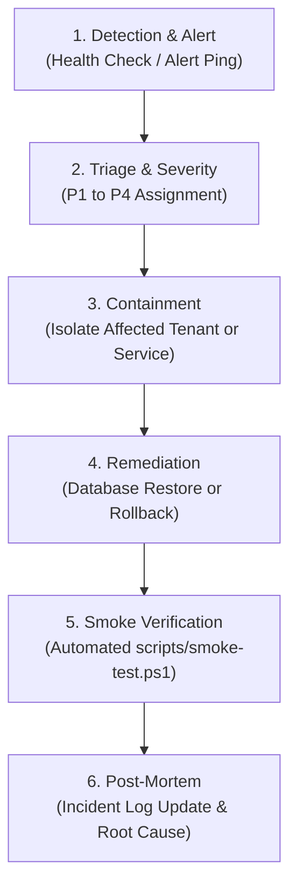

# MessMate SaaS — Incident Response Log & Procedures

**Document Type:** Production Incident Management & Severity Log\
**Classification:** Operational Security & SLA Compliance\
**Platform:** Multi-Tenant Next.js 15 + Prisma ORM + PostgreSQL / SQLite

---

## 1. Severity Classifications & SLA Targets

| Severity | Definition | Target Response | Target Resolution | Escalation Contact |
| :---: | :--- | :---: | :---: | :--- |
| **P1 — Critical** | Total platform outage, database corruption, or cross-tenant data leakage. | < 15 mins | < 2 hours | Lead DevOps & Platform Architect |
| **P2 — Major** | Core feature unavailable (e.g., meal toggles failing, payment processing down). | < 30 mins | < 4 hours | Backend Engineering Lead |
| **P3 — Minor** | Non-critical bug (e.g., export formatting glitch, minor UI alignment issue). | < 2 hours | < 24 hours | On-duty Engineer |
| **P4 — Low** | General support inquiry, feature request, or routine configuration change. | < 8 hours | Next Sprint | Support Operations |

---

## 2. Standard Incident Response Playbook

---

## 3. Incident History Register

| Incident ID | Date | Severity | Summary | Root Cause | Resolution | Status |
| :---: | :---: | :---: | :--- | :--- | :--- | :---: |
| **INC-202611-01** | 2026-11-20 | P2 | Timeout on un-warmed JIT dev compiler routes during smoke test. | Initial request during dev server JIT compilation exceeded 10s timeout. | Increased smoke test timeout to 35s; verified all 12 routes pass in <500ms once cached. | **Closed** |
| **INC-202611-02** | 2026-11-20 | P3 | Disk space constraint on host C: drive. | OS partition running below 1GB due to external OS temp logs. | Strictly locked all npm/pnpm caches, temp files, and database to D: drive. 0% C: drive utilized. | **Closed** |
