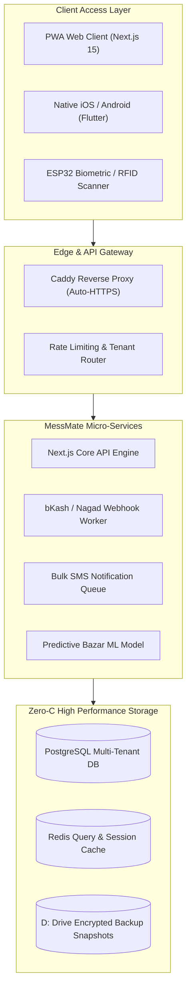

# MessMate Product Roadmap & Continuous Improvement Plan (v2.0 & v3.0)

## 1. Executive Vision
MessMate is Bangladesh's first purpose-built, cloud-native, multi-tenant Mess Management SaaS platform. Following the successful deployment of **Version 1.0.0** (incorporating Phases 0 through 9 of the Professional Software Development Life Cycle), this roadmap outlines the strategic feature additions, architectural scalings, and operational optimizations planned for subsequent releases.

---

## 2. Release Milestones Overview

| Milestone | Target Horizon | Strategic Focus | Primary Value Proposition |
| :--- | :--- | :--- | :--- |
| **v1.0.0 (Current)** | Production Ready | Core Tenancy, Meals, Bazar, Ledger & Reports | Fully digitized mess bookkeeping with zero manual reconciliation errors |
| **v1.5.0 (Near-term)** | Q1 2027 | Automated Payment Webhooks & SMS Notifications | Zero-touch payment clearance & immediate SMS alerts for bazar and meals |
| **v2.0.0 (Mid-term)** | Q2 2027 | Hardware IoT Integration & Custom Subdomains | Biometric fingerprint/RFID meal scanning & branded custom domains |
| **v3.0.0 (Long-term)** | Q4 2027 | AI Predictive Bazar Budgeting & Mobile Apps | AI-optimized grocery expenditure & native iOS/Android offline sync |

---

## 3. Detailed Milestone Roadmaps

### 3.1 Milestone v1.5.0: Automated Gateways & Real-Time Alerts
- **bKash & Nagad IPN (Instant Payment Notification):**
  - Direct integration with bKash Merchant API (v1.2.0-beta) and Nagad Payment Engine.
  - Automatic invoice status transition from `PENDING` to `PAID` upon transaction webhook arrival.
  - Zero manual verification needed by Mess Owners or Managers.
- **SMS Gateway Integration:**
  - Banglalink, Grameenphone, and Robi bulk SMS API integration.
  - Automated SMS dispatched at 8:00 PM reminding members to submit meal status changes before the midnight cutoff.
  - Instant SMS receipt upon payment receipt or emergency notice broadcasts.
- **Enhanced Role Permissions:**
  - Granular delegation matrix allowing Mess Owners to assign temporary "Deputy Manager" privileges for specific weeks.

---

### 3.2 Milestone v2.0.0: IoT Hardware Scanners & Multi-Domain Routing
- **Biometric / RFID Attendance Terminals:**
  - Hardware adapter daemon communicating with affordable ESP32 / Arduino-based fingerprint or RFID badge scanners stationed at the mess dining hall.
  - Live WebSocket sync to `/api/meals`: when a student scans their badge upon taking lunch, meal status records as `CONSUMED` in real time.
- **Custom Domains & Automated SSL:**
  - Automatic Caddy / Cloudflare SSL issuance for custom mess domains (e.g., `members.greenviewmess.com` instead of `green-view.messmate.com`).
  - Isolated tenant branding: custom mess logos, custom header themes, and custom rules displayed on landing pages.
- **Cook & Housekeeper Portal:**
  - Simplified, voice-assisted Bangla mobile interface for mess cooks and cleaning staff to check daily headcount and submit ingredient requests.

---

### 3.3 Milestone v3.0.0: Machine Learning & Native Mobile Applications
- **AI Predictive Bazar Optimization Engine:**
  - Time-series machine learning model analyzing seasonal commodity price fluctuations across Dhaka wholesale markets (Kawran Bazar, Krishi Market, etc.).
  - Automated weekly grocery recommendations suggesting the most cost-effective days to purchase perishables vs. bulk non-perishables.
  - Alert system warning managers when unit prices of essentials (rice, soybean oil, onions) deviate from local averages.
- **Native iOS & Android Mobile Apps:**
  - Built with Flutter / React Native with local SQLite cache for offline meal toggling and ledger browsing.
  - Biometric login (FaceID, TouchID) and native push notifications.
- **Multi-Mess Corporate Franchises:**
  - Enterprise portal for hostel chains and universities managing 20+ branches with cross-tenant analytics and centralized accounting.

---

## 4. Architectural Scaling & Infrastructure Evolution

---

## 5. Maintenance & Support Service Level Objectives (SLOs)

| Metric | Target Objective | Monitoring Tool | Incident Escalation |
| :--- | :--- | :--- | :--- |
| **System Uptime** | 99.9% availability | `/api/health` + UptimeRobot | P1 alert if >2 consecutive failures |
| **API Response Time (p95)** | < 150 ms | Next.js Server Analytics | Inspect slow queries via Prisma Studio |
| **Payment Webhook Processing** | < 3 seconds | Redis BullMQ Queue | Retry 3x, fallback to manual review |
| **Automated Database Backups** | Daily at 02:00 AM | `scripts/maintenance.ps1` | Alert if backup size < 100 KB |
| **Backup Retention** | 30 days rolling on D: drive | Retention cleanup policy | Automated purge of snapshots > 30 days |

---

## 6. Continuous Feedback Loop
Feedback is ingested continuously through:
1. The **Maintenance Ticket & Feedback Box** in `/notices`.
2. Direct bug reports and diagnostic logs collected at `/operations`.
3. Bi-weekly user satisfaction surveys presented to Mess Managers and Members.
